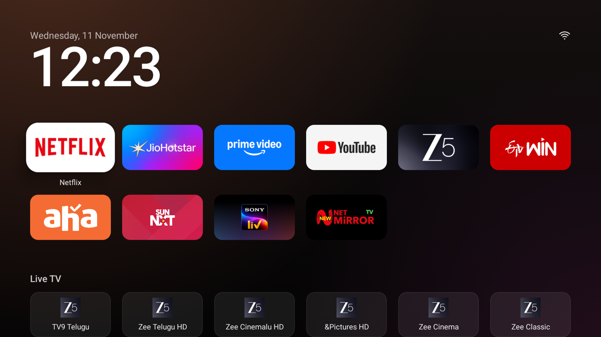
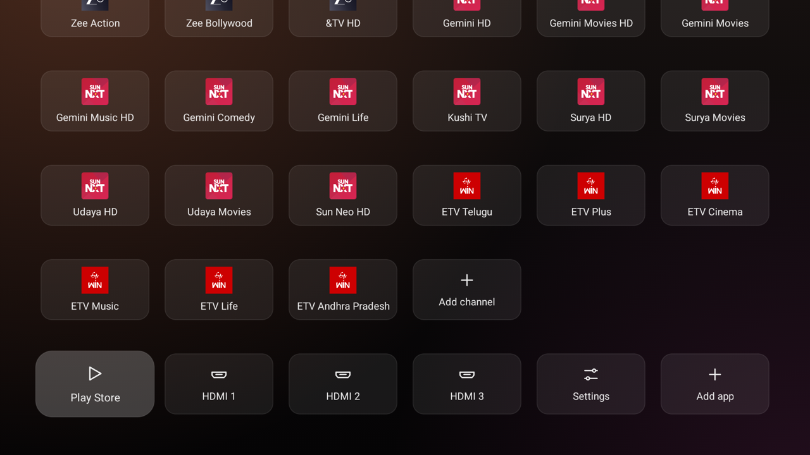
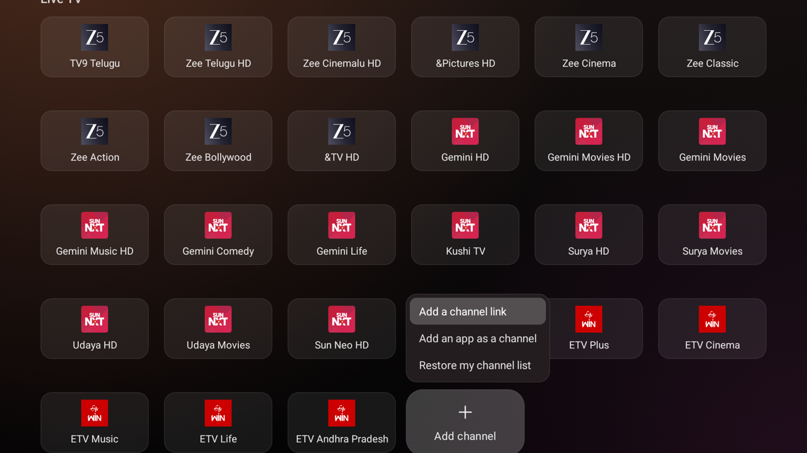
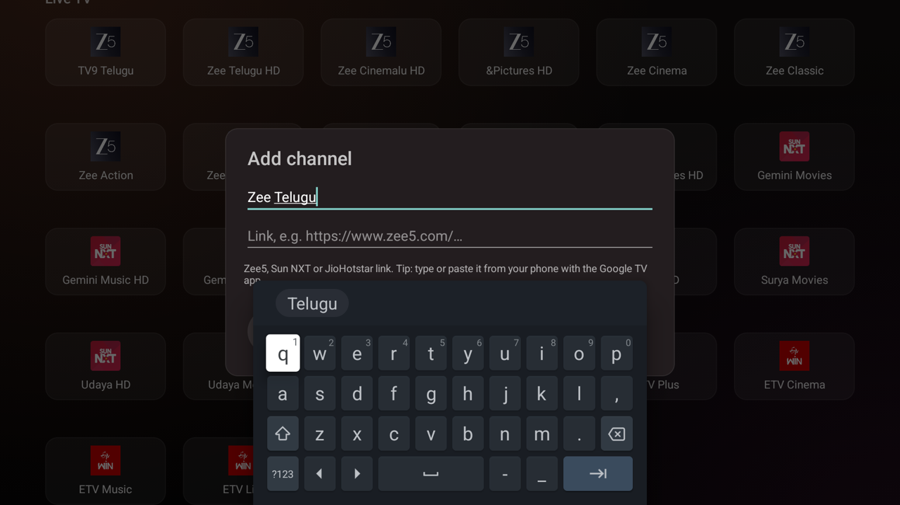
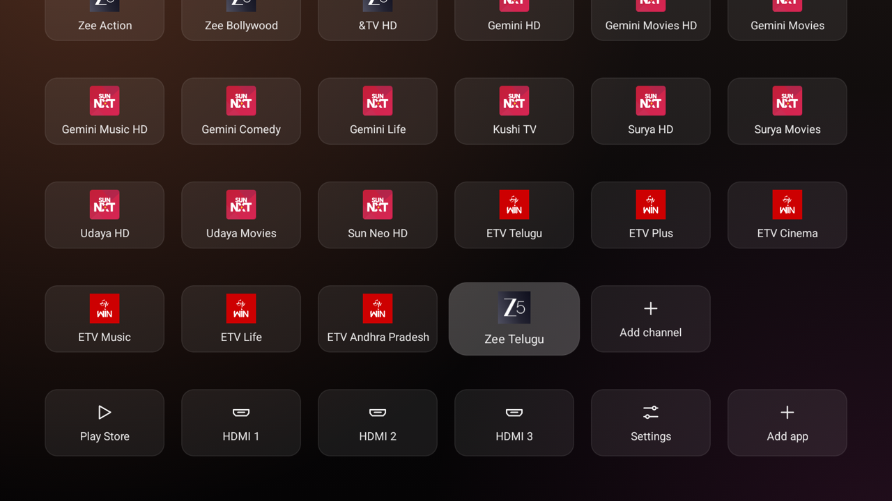
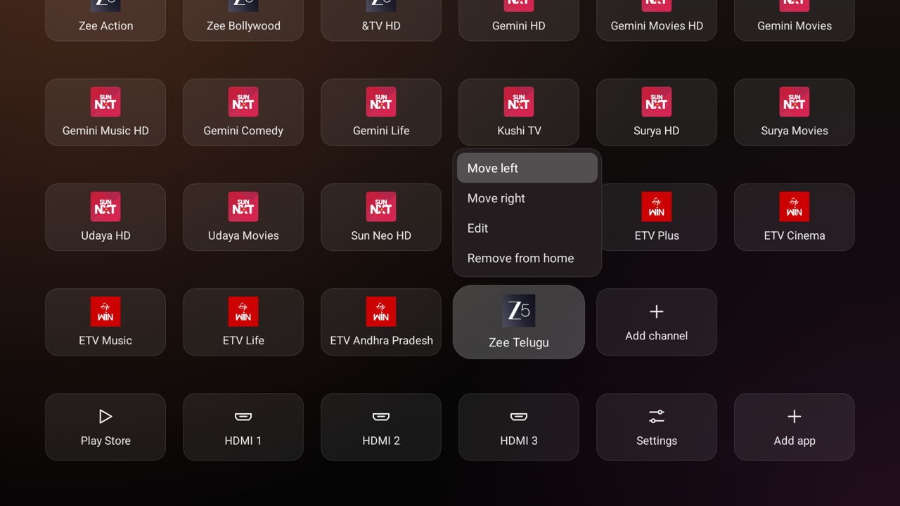

# Haier Google TV: cleanup + Live TV home screen

A record of cleaning up a **Haier MatrixTV DE** (Google TV, Android 14, 1.8 GB RAM) over Wi-Fi with `adb`, and adding a **Live TV row** to the [tv-detox](https://github.com/Ansub/tv-detox) home screen. Each tile on the row opens a live channel straight inside **Zee5** or **Sun NXT**.

No root. Nothing was uninstalled: system apps were *turned off* (`pm disable-user`) and every change can be undone.



> ⚠️ **Risk.** Turning off system apps has, on some TVs, left the TV stuck at the logo or restarting. Everything here was done one change at a time, with an undo list, and the TV was restarted and checked afterwards. If you copy this, keep the undo scripts and stay away from the "never turn off" list below.

---

## Contents

1. [Connecting to the TV over Wi-Fi](#1-connecting-to-the-tv-over-wi-fi)
2. [What was on the TV](#2-what-was-on-the-tv)
3. [What was turned off, and what was kept](#3-what-was-turned-off-and-what-was-kept)
4. [Settings changed](#4-settings-changed)
5. [The tv-detox home screen](#5-the-tv-detox-home-screen)
6. [Restart check and results](#6-restart-check-and-results)
7. [New feature: the Live TV row](#7-new-feature-the-live-tv-row)
8. [How the channel links were worked out](#8-how-the-channel-links-were-worked-out)
9. [Building and installing](#9-building-and-installing)
10. [Undo everything](#10-undo-everything)
11. [Files](#11-files)

---

## 1. Connecting to the TV over Wi-Fi

1. On the TV, go to **Settings → System → About → Build** and press OK 7 times to unlock Developer options.
2. In **Settings → System → Developer options**, turn on **USB debugging** and **Wireless debugging**.
3. On Android 11+, Wireless debugging needs a one-time pairing. Open **Wireless debugging → Pair device with pairing code**, then on the computer run:

   ```sh
   adb pair <TV_IP>:<pairing port> <6-digit code>
   adb connect <TV_IP>:<port shown on the Wireless debugging screen>
   ```

The port changes after every restart. Once paired, `adb devices` finds the TV again by its `adb-…._adb-tls-connect._tcp` name.

`adb` came from Google's [platform-tools](https://developer.android.com/tools/releases/platform-tools). The Homebrew cask was returning a 404 at the time.

## 2. What was on the TV

| | |
|---|---|
| Model | Haier MatrixTV DE (product `HR9676EUF`, device `omonia`) |
| OS | Google TV, Android 14 (SDK 34) |
| RAM | 1.8 GB, about **480 MB free** before any change |
| Apps | 178 system apps, 10 user-installed |
| Home screen | Google TV (`com.google.android.apps.tv.launcherx`) |

Haier had already turned off six apps itself (Haier Evo, hOn onboarding, the ATSC and ISDB tuners, and others). Those were left alone.

## 3. What was turned off, and what was kept

Only apps that are **not** always-running (`PERSISTENT`) and not needed to start the TV were offered, and each was approved one by one.

| App | Package | Result |
|---|---|---|
| YouTube Music | `com.google.android.youtube.tvmusic` | Off |
| Google Play Games | `com.google.android.play.games` | Off |
| Google Feedback | `com.google.android.feedback` | Off |
| Retail demo mode | `com.mediatek.tv.retaildemo` | Off |
| Anoki ACR (recognises what's on screen for ads) | `tv.anoki.acr.anokiacroptin` | Off |
| Haier e-Manual | `com.haier.emanual9603` | Off |
| Haier TV Housekeeper | `com.haier.tvhousekeeper` | Off |
| Miracast screen mirroring | `com.mediatek.miracast` | Off |
| Haier Gaming Bar | `com.haier.gamingbar` | **Came back on after the restart.** Haier's own app manager (`com.haier.appmanager.dispatcher`, shown as `lastDisabledCaller`) turns it back on at every boot, so it was left on. |

**Never turned off:** Google Play services (`com.google.android.gms`), Play Store, Settings, System UI, setup apps (`setupwraith`, `partnersetup`), Gboard, Bluetooth and Haier's Bluetooth helpers, HDMI/TV input and tuner framework (`com.mediatek.tis`, DVB tuner, TV Center, `com.android.providers.tv`), Google TV's home screen and screensaver, the remote service, backlight and Dolby services, the system updater, and every `PERSISTENT` app (Haier smart device, DIAL, hOn service…).

**Kept by choice:** Chromecast built-in, Google Assistant / voice search, and the USB media player.

## 4. Settings changed

| Setting | Before | After |
|---|---|---|
| `global window_animation_scale` | 1.0 | 0 |
| `global transition_animation_scale` | 1.0 | 0 |
| `global animator_duration_scale` | 1.0 | 0 (*reset to 1.0 at the restart; set again*) |
| `secure sleep_timeout` (TV sleeps) | 20 min | **5 min** |
| `system screen_off_timeout` (screensaver starts) | 10 min | **3 min** |
| Screensaver | on | on (kept, in case the panel is OLED) |

## 5. The tv-detox home screen

[tv-detox](https://github.com/Ansub/tv-detox) installs a clean, Apple TV-style home screen. Installed with the app row in this order: Netflix, JioHotstar, Prime Video, YouTube, Zee5, ETV Win, Aha, Sun NXT, SonyLIV, NetMirrorTV.

On Google TV, tv-detox deliberately **keeps Google TV's own home screen on** (turning it off has left some Google TVs stuck restarting). So the Home button still opens Google TV's screen, and you open the new home screen from the Apps row. tv-detox has an optional **Settings → Accessibility → Home button** switch that makes Home open it instead.

## 6. Restart check and results

The TV was left 30 seconds after the last change, then restarted once. Afterwards:

- Startup finished normally (`sys.boot_completed=1`) and the Google TV home screen opened.
- Every protected app was still on.
- 8 of the 9 apps turned off were still off; Gaming Bar came back on, as explained above.

| | Free memory (MemAvailable) |
|---|---|
| Before | ~480 MB |
| After restart | ~490–510 MB |

The memory gain is small. The apps that use the most memory (Google TV's home screen, Play services, Assistant) can't safely be turned off on Google TV. What makes the TV *feel* faster is having animations off.

---

## 7. New feature: the Live TV row

There's no way to automatically "save the channel I'm watching". The TV reports the *title* of what's playing (`dumpsys media_session`), but not a link that could reopen it, and Android doesn't let one app read where another app is inside itself. Instead, the home screen gained a row of **channel tiles that each hold a link**, plus a tile for adding any live channel link.



**27 channels to start with:**

| App | Channels | Opens |
|---|---|---|
| **Zee5** | TV9 Telugu, Zee Telugu HD, Zee Cinemalu HD, &Pictures HD, Zee Cinema, Zee Classic, Zee Action, Zee Bollywood, &TV HD | ✅ straight into the live channel |
| **Sun NXT** | Gemini HD, Gemini Movies HD, Gemini Movies, Gemini Music HD, Gemini Comedy, Gemini Life, Kushi TV, Surya HD, Surya Movies, Udaya HD, Udaya Movies, Sun Neo HD | ✅ straight into the live channel |
| **ETV Win** | ETV Telugu, ETV Plus, ETV Cinema, ETV Music, ETV Life, ETV Andhra Pradesh | ⚠️ opens the app only (ETV Win accepts no links) |
| **JioHotstar** | (none) | ❌ no live TV links in the app |

### Adding any channel

Select **Add channel** (the + at the end of the row):



- **Add a channel link:** enter a name and a Zee5 / Sun NXT / JioHotstar link. Typing it from your phone with the **Google TV app's keyboard** is far easier than using the remote.
- **Add an app as a channel:** for apps with no channel links (like ETV Win).
- **Restore my channel list:** goes back to the 27 above.



The new tile appears at the end of the row with the app's icon:



**Hold OK (or press Menu) on a channel** to move it, edit it, or remove it:



**From a computer:**

```sh
sh add-channel.sh <TV_IP:PORT> "Zee Telugu" "https://www.zee5.com/channels/details/zee-telugu/0-9-9z5383485"
sh add-channel.sh <TV_IP:PORT> reset
```

### Link formats the tiles understand

| Link | Goes to |
|---|---|
| `https://www.zee5.com/…/0-9-<id>` | Zee5. Any Zee5 URL containing the channel id works, because the app pulls the id out with the pattern `[0-9]-[0-9]-[a-zA-Z0-9-]+`. |
| `https://www.sunnxt.com/live/<slug>/<id>/<slug>` | Converted to `sunnxt://playback?source=deeplink&id=<id>` for the Sun NXT TV app |
| `sunnxt://playback?source=deeplink&id=<id>` | Sun NXT |
| `https://www.hotstar.com/…` | JioHotstar |
| `app:<package>` | Just opens that app |
| anything else | Whatever app on the TV accepts it |

## 8. How the channel links were worked out

- **Which links each app accepts:** `dumpsys package <pkg>` lists each app's link filters. Zee5 accepts `https://www.zee5.com` and `zee5://` links, Sun NXT only `sunnxt://` links, JioHotstar `https://www.hotstar.com` links, and ETV Win **none**.
- **Zee5:** opening `https://www.zee5.com/live-tv/x/0-9-zeetelugu` went straight to the player. Channel ids came from Zee5's public live-TV sitemap. Each one was opened on the TV and checked with `dumpsys media_session`, which showed the expected channel name playing.
- **Sun NXT:** simple guesses (`sunnxt://playback/<id>`, `sunnxt://deeplink/<id>`) opened the app but didn't play anything. The TV app's link handler needs a `source` value in the link. `sunnxt://playback?source=deeplink&id=<id>` plays the channel, both when the app is closed and when it's already open. Channel ids are the numbers in Sun NXT's public channel sitemap (`sunnxt.com/sitemap/channels.xml`).
- **JioHotstar:** has no live TV channel links.

Verified ids:

| Zee5 | id | | Sun NXT | id |
|---|---|---|---|---|
| TV9 Telugu | `0-9-258` | | Gemini HD | `194392` |
| Zee Telugu HD | `0-9-zeetelugu` | | Gemini Movies HD | `192537` |
| Zee Telugu | `0-9-9z5383485` | | Gemini Movies | `194384` |
| Zee Cinemalu HD | `0-9-zeecinemalu` | | Gemini Music HD | `194393` |
| &Pictures HD | `0-9-tvpictureshd` | | Gemini Comedy | `194394` |
| Zee Cinema | `0-9-zeecinema` | | Gemini Life | `194337` |
| Zee Cinema HD | `0-9-zeecinemahd` | | Kushi TV | `194346` |
| Zee Classic | `0-9-176` | | Surya HD | `194397` |
| Zee Action | `0-9-zeeaction` | | Surya Movies | `194385` |
| Zee Bollywood | `0-9-zeeclassic` (sic) | | Udaya HD | `194399` |
| &TV HD | `0-9-tvhd_0` | | Udaya Movies | `194386` |
| | | | Sun Neo HD | `194389` |

Live channels on both apps need a subscription that includes live TV. If an app changes a channel's id, that tile opens the app's home page instead; edit the tile with a fresh link.

## 9. Building and installing

The code changes are in [`tv-detox/`](tv-detox/):

- [`src/com/ansub/tvhome/LiveTv.java`](tv-detox/src/com/ansub/tvhome/LiveTv.java) (new): the channel list, saving it, and turning links into launch intents.
- [`src/com/ansub/tvhome/MainActivity.java`](tv-detox/src/com/ansub/tvhome/MainActivity.java): the Live TV row, the channel and + menus, the add/edit form, the `addchannel` / `channels` extras, and stopping focus from jumping to the Wi-Fi icon.
- [`AndroidManifest.xml`](tv-detox/AndroidManifest.xml): link `<queries>` so Android 11+ shows the home screen which apps open links.

To build, you need Java 17 and the Android SDK (platform 34, build-tools 34):

```sh
brew install openjdk@17
export JAVA_HOME=/opt/homebrew/opt/openjdk@17 ANDROID_HOME=/path/to/android-sdk
sh tv-detox/build.sh              # -> tv-detox/out/tvhome.apk (makes key.jks on first build; keep it private)
sh tv-detox/install.sh <TV_IP:PORT> "com.netflix.ninja,in.startv.hotstar,…"
```

To change the channels it starts with, edit `DEFAULTS` in `LiveTv.java`.

## 10. Undo everything

```sh
sh undo-my-changes.sh <TV_IP:PORT>                 # turns the apps back on, restores the settings
PATH=$PWD/tools/platform-tools:$PATH \
  sh tv-detox/undo.sh <TV_IP:PORT>                 # removes the home screen
```

[`changes-undo-list.txt`](changes-undo-list.txt) is the undo list both scripts read, and [`CHANGES.md`](CHANGES.md) has every change with its own undo command.

> 🔒 **When you're done, turn off USB / Wireless debugging** (Settings → System → Developer options). While it's on, other devices on your network can ask to control the TV. Turn it back on only to undo or update.

## 11. Files

| Path | What |
|---|---|
| `README.md` | This page |
| `CHANGES.md` | Change log with undo commands |
| `changes-undo-list.txt` | Undo list (apps turned off, old setting values) |
| `undo-my-changes.sh` | Turns everything back on |
| `add-channel.sh` | Adds a Live TV channel from a computer |
| `backup/` | App lists from before any change |
| `tv-detox/` | tv-detox with the Live TV row added |
| `screenshots/` | The screenshots above |

## Credits

- Home screen: [Ansub/tv-detox](https://github.com/Ansub/tv-detox) (MIT). Its licence is kept in [`tv-detox/LICENSE`](tv-detox/LICENSE).
- Zee5, Sun NXT, ETV Win, JioHotstar and the channel names are trademarks of their owners. This project only opens their apps; it contains no streams or app code.
